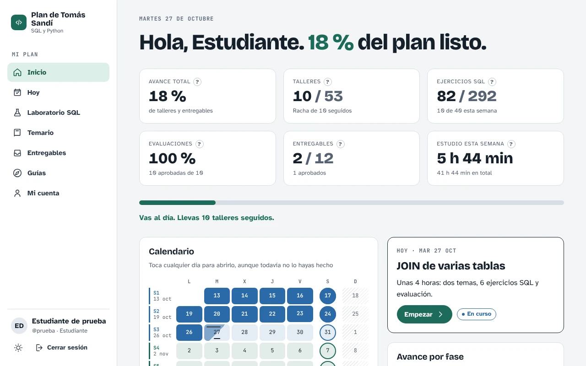
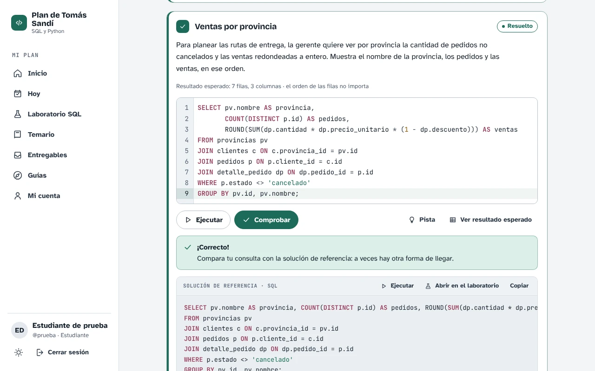
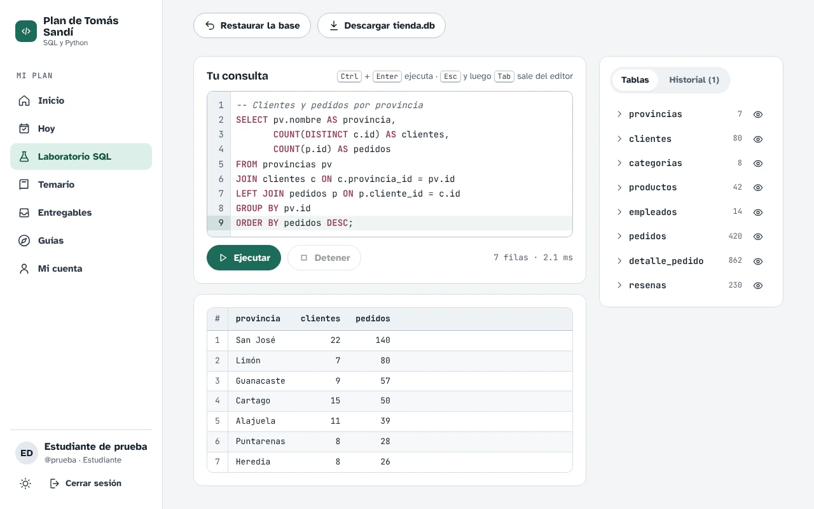
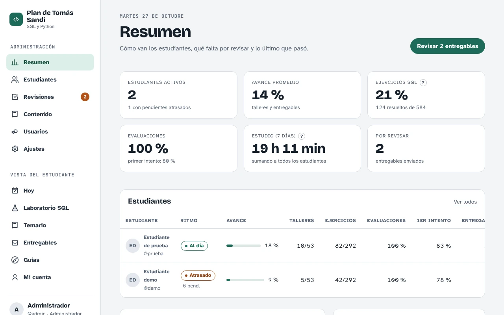
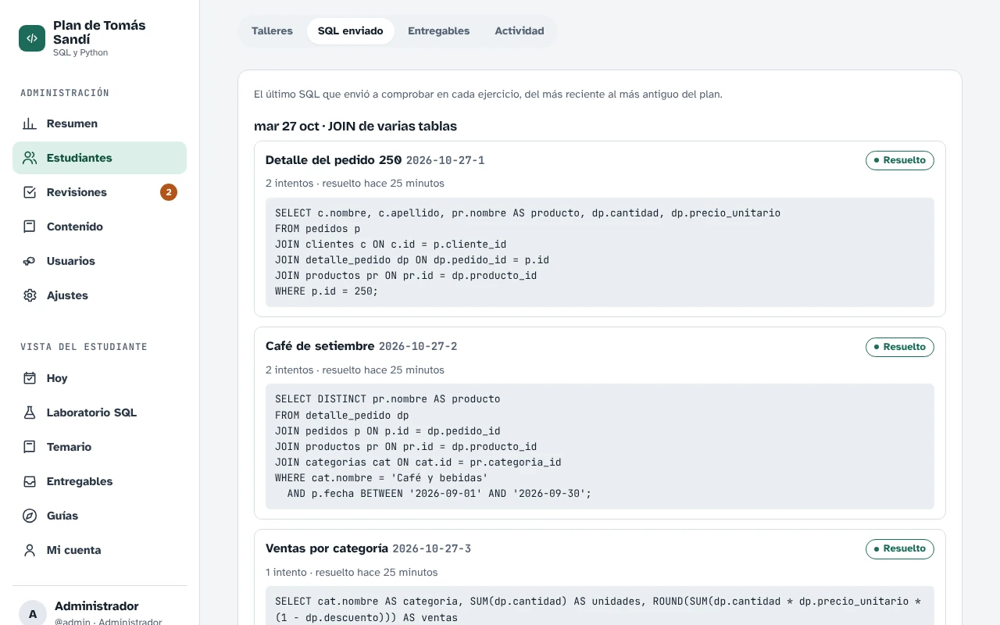
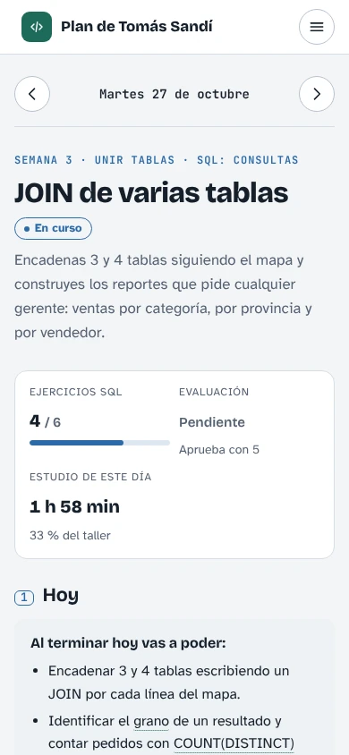
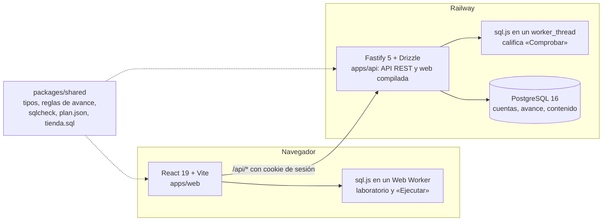

# Plan de Tomás Sandí · SQL y Python

[](https://github.com/ronalc90/tomas-page/actions/workflows/ci-cd.yml)

Plataforma web para que Tomás Sandí (Costa Rica) aprenda **SQL** primero y luego **Python**, del **13 de octubre al 30 de diciembre de 2026**, con unas 4 horas de estudio al día de lunes a viernes (sin los feriados de Costa Rica). Es para un estudiante que empieza de cero y para quien lo acompaña: el estudiante sigue su plan día a día y el administrador ve su avance, revisa las entregas y edita el contenido.

- **Estudiar el taller del día:** dos temas con concepto, ejemplo, consejo, guía paso a paso y errores comunes, más glosario con tooltips y reto extra.
- **Practicar SQL de verdad:** ejercicios que **se califican solos** y un **laboratorio SQL** que corre en el navegador sobre la base de práctica «Tienda Pura Vida».
- **Demostrar lo aprendido:** una evaluación de 8 preguntas por taller y un entregable cada sábado.
- **Seguir el avance:** tablero con calendario, minutos de estudio y racha; panel de administración con métricas, el último SQL enviado en cada ejercicio, cola de revisión, editor de contenido y cuentas.

**App en línea:** https://tomas-page-production.up.railway.app (se entra con usuario y contraseña). La dirección vieja de GitHub Pages, https://ronalc90.github.io/tomas-page/, redirige ahí.

## Capturas

Tomadas con Playwright sobre la app corriendo en local, con el plan real, `FAKE_TODAY=2026-10-27` y cuentas de prueba (sin datos reales).



<table>
  <tr>
    <td width="50%"><br><sub><b>Taller del día:</b> el ejercicio se califica en el servidor y luego aparece la solución de referencia.</sub></td>
    <td width="50%"><br><sub><b>Laboratorio SQL:</b> SQLite en el navegador, explorador de tablas e historial.</sub></td>
  </tr>
  <tr>
    <td width="50%"><br><sub><b>Administración:</b> métricas, ritmo de cada estudiante y entregables por revisar.</sub></td>
    <td width="50%"><br><sub><b>Detalle por estudiante:</b> el último SQL que envió en cada ejercicio.</sub></td>
  </tr>
</table>

<p align="center">
  <br>
  <sub><b>En el celular</b> (390 × 844): el mismo taller con el menú plegado.</sub>
</p>

## Qué incluye

| | |
|---|---|
| **Contenido** | 12 semanas en 4 fases: SQL consultas → SQL avanzado y diseño → Python → Python + SQL y proyecto final. Se escribe en `content/semanas/sNN.json` (ver `content/GUIA_DE_CONTENIDO.md`) y `scripts/plan.py` lo valida y arma `packages/shared/src/data/plan.json` |
| **Estudiante** | Tablero (avance, ejercicios, minutos de estudio de la semana), calendario por colores, taller del día con ejercicios SQL, laboratorio SQL, evaluación calificada en el servidor, entregables con preguntas que se califican solas y comentarios del revisor, temario y guías |
| **Administración** | Resumen con métricas, ejercicios y minutos por semana; detalle por estudiante con el último SQL enviado en cada ejercicio; cola de revisión; editor de talleres, preguntas y ejercicios; usuarios y ajustes |
| **Stack** | React 19 + Vite + TypeScript + CodeMirror 6 · Fastify 5 + Drizzle ORM · PostgreSQL 16 · sql.js (SQLite en WebAssembly) · Railway |

## Ejercicios SQL y laboratorio

- **Laboratorio** (`/laboratorio`, en el menú): editor CodeMirror con dialecto SQLite, autocompletado de tablas y columnas y Ctrl/Cmd + Enter; explorador de tablas con columnas, tipos y llaves; varias sentencias por script; resultados de hasta 1 000 filas con NULL resaltado; errores de SQLite explicados en español; historial de las últimas 20 consultas; restaurar la base original y descargar `tienda.db`. SQLite corre en un Web Worker con [sql.js](https://sql.js.org): una consulta pesada no congela la página y **Detener** la corta. Los cambios duran mientras la pestaña está abierta.
- **Ejercicios** (en cada taller y en los entregables de SQL): **Ejecutar** corre la consulta en el navegador sobre una copia limpia (no cuenta como intento); **Comprobar** la califica en el servidor. Se ven la pista, el resultado esperado y, después de 3 intentos, la solución (queda registrado). Al resolverlo aparece la solución de referencia.
- **Cómo se califica** (`packages/shared/src/sqlcheck.ts`, igual que `validar_ejercicio` de `scripts/plan.py`): copia limpia de la base → `setup` → SQL del estudiante → `check` si existe; se compara la última sentencia que devuelve filas con la de la solución. Cuentan los valores (no los nombres de columna), el número y el orden de las columnas, los decimales redondeados a 2 cifras y el orden de las filas solo si el ejercicio lo pide. En el servidor el SQL corre con sql.js en un `worker_thread` con límite de 3 s (si se pasa, se termina el worker y se crea otro), hasta 20 000 caracteres y 1 000 filas.
- **Los ejemplos SQL de las lecciones** se pueden ejecutar ahí mismo o abrir en el laboratorio.
- **Tiempo de estudio**: con la pestaña visible y actividad (teclado, mouse o desplazamiento) en los últimos 3 minutos, la página envía un aviso por minuto y el servidor suma 1 minuto al día (como máximo uno cada 50 s).

## Arquitectura



```
apps/
  web/        React + React Router + TanStack Query (la interfaz)
  api/        Fastify + Drizzle: API REST, sesiones, reglas de avance; sirve la web compilada
    drizzle/  migraciones SQL versionadas
packages/
  shared/     tipos, validaciones (zod), reglas de avance y fechas, usados por web y API
    src/data/plan.json     contenido del plan (lo arma scripts/plan.py desde content/semanas)
    src/data/guides.json   guías generales
    src/data/tienda.sql    base de práctica «Tienda Pura Vida» (SQLite)
    src/sqlcheck.ts        calificación de ejercicios SQL (servidor y navegador)
content/      el contenido por semana (sNN.json), la guía para escribirlo y el temario
scripts/      plan.py (valida y construye el plan) y generar_tienda.py
fixtures/     plan de prueba pequeño que usan las pruebas (no dependen del contenido real)
e2e/          pruebas de punta a punta con Playwright
docs/capturas/ capturas de este README
```

Un solo servicio sirve la API (`/api/*`) y la aplicación web, así no hay problemas de CORS ni cookies entre dominios. Al arrancar, el servidor aplica las migraciones pendientes y carga el contenido y las cuentas iniciales si no existen.

### Decisiones importantes

- **Las evaluaciones se califican en el servidor.** Cuatro tipos de pregunta (opción múltiple, verdadero/falso, «¿qué muestra?» y completar código); las reglas de calificación viven en `packages/shared/src/quiz.ts`. Las respuestas correctas nunca viajan al navegador antes de presentar; después de cada intento llega la revisión con explicación, comentario por opción y respuesta correcta. Se guardan todos los intentos y las pistas usadas: el panel muestra la mejor nota, la del primer intento, las pistas y si hizo el reto.
- **Un taller está completo** cuando sus tareas (si tiene) están marcadas, todos sus ejercicios SQL están resueltos y la evaluación está aprobada (nota mínima configurable, por defecto 5 de 8). Un entregable con ejercicios solo se puede enviar con todos resueltos. Lo que tiene fecha anterior a hoy y no está completo queda **atrasado**. "Hoy" se calcula en la zona horaria de Costa Rica.
- **Las reglas de avance viven en `packages/shared/src/progress.ts`**, así el estudiante y el administrador ven exactamente lo mismo.
- **Sesiones con cookie `httpOnly`, `SameSite=Lax` y `Secure`** en producción; en la base solo se guarda el hash del token. Contraseñas con bcrypt. Límite de intentos de inicio de sesión por IP y usuario. Cabeceras de seguridad con Helmet (CSP estricta; solo se abre `'wasm-unsafe-eval'` para WebAssembly y `worker-src 'self' blob:` para el worker de SQL).
- **Las ediciones del administrador se respetan:** el contenido inicial solo se carga si la base está vacía. Para recargarlo a propósito: `npm run db:seed -- --reset-content`. Cuando cambia la estructura del plan (`CONTENT_VERSION` en `apps/api/src/db/seed.ts`, hoy 4), al arrancar se reemplaza el contenido conservando el avance de los estudiantes en las fechas y entregables que siguen existiendo; lo que ya no está en el plan se borra.
- **El progreso vive solo en el backend.** La antigua versión sin servidor (GitHub Pages) se retiró; GitHub Pages publica solo una página que redirige a la app.

## Cuentas iniciales

Se crean la primera vez que arranca el servidor, con las variables `SEED_*`:

| Usuario | Rol | Contraseña |
|---|---|---|
| `tomas` (Tomás Sandí) | Estudiante | `SEED_STUDENT_PASSWORD` (en producción: `1234`) |
| `admin` | Administrador | `SEED_ADMIN_PASSWORD` (variable secreta en Railway) |
| `prueba` | Estudiante de prueba | `SEED_TEST_PASSWORD` (en desarrollo: `prueba123`; en producción solo se crea si defines la variable) |

Si una cuenta ya existe, su contraseña no se toca. Las contraseñas se cambian desde **Mi cuenta** o desde **Administración → Usuarios**.

## Desarrollo local

Requisitos: Node 22 y PostgreSQL 16.

```bash
npm install
cp .env.example .env            # ajusta DATABASE_URL
createdb tomas_dev
export $(grep -v '^#' .env | xargs)
npm run dev                      # migra, carga datos y abre API (3000) + web (5173)
```

¿Sin PostgreSQL instalado? Con Docker basta: `docker run -d --name tomas-db -e POSTGRES_PASSWORD=postgres -e POSTGRES_DB=tomas_dev -p 5432:5432 postgres:16` (ya crea `tomas_dev`, así que te saltas el `createdb`).

Abre http://localhost:5173 y entra con `prueba` / `prueba123` (estudiante) o con `admin` y la clave de `SEED_ADMIN_PASSWORD` del `.env`. Para ver el plan como si fuera otro día, define `FAKE_TODAY=2026-10-15` (se ignora en producción). Para cargar otro archivo de plan (por ejemplo el de prueba), define `PLAN_FILE=fixtures/plan.json` antes de crear la base.

Para reconstruir el plan desde el contenido: `python3 scripts/plan.py construir` (valida todas las semanas y escribe `plan.json`).

## Pruebas

```bash
createdb tomas_test && createdb tomas_e2e
npm run lint        # ESLint
npm run typecheck   # TypeScript en los tres paquetes
npm test            # Vitest: calificación SQL, reglas de avance, API contra PostgreSQL real y componentes de la web
npm run build
npm run e2e         # Playwright: ejercicios, laboratorio, entregables y administración (escritorio y celular)
```

Las pruebas usan el plan pequeño de `fixtures/plan.json`, no el contenido real; la única excepción es `apps/api/test/plan-real.test.ts`, que comprueba que el `plan.json` real carga, que el administrador podría editar cada día y que la solución de cada ejercicio corre en sql.js (para revisar un plan provisional sin reemplazarlo: `PLAN_REAL_FILE=/ruta/plan.json npx vitest run test/plan-real.test.ts` en `apps/api`). Las pruebas de la API crean una base limpia (`tomas_test`) con las migraciones reales. Las de punta a punta levantan el servidor compilado con una base propia (`tomas_e2e`).

## CI/CD

`.github/workflows/ci-cd.yml` corre en cada push y pull request:

1. **Calidad y pruebas:** lint, tipos, pruebas con PostgreSQL 16, compilación y Playwright.
2. **Imagen Docker:** construye la imagen de producción, la arranca contra PostgreSQL y verifica `/api/health` (incluye el motor de SQL de los ejercicios: `"sql":"ok"`).
3. **GitHub Pages redirige a la app:** solo en `main` (o a mano); publica una página mínima que lleva a `APP_URL` (con un enlace visible «El plan se mudó a …» y conservando la ruta de los enlaces viejos).
4. **Desplegar en Railway:** solo en `main` (o a mano), después de las pruebas y la imagen Docker. Sube el código con `railway up`, espera la compilación y comprueba que `/api/health` responde con la versión (commit) recién desplegada.

Configuración que usa el despliegue (en GitHub → Settings):

| Tipo | Nombre | Valor |
|---|---|---|
| Secret (entorno `production`) | `RAILWAY_TOKEN` | Token de proyecto de Railway (entorno `production`) |
| Variable (opcional) | `RAILWAY_SERVICE` | Nombre del servicio de la app en Railway; si no existe, se usa `tomas-page` |
| Variable (opcional) | `APP_URL` | URL pública; si no existe, se usa `https://tomas-page-production.up.railway.app` (también es el destino de la página de GitHub Pages) |

## Railway

Proyecto con dos servicios: **PostgreSQL** y la **app** (compilada con el `Dockerfile`; `railway.json` define la verificación de salud en `/api/health`). La imagen lleva el `.wasm` de sql.js (en `node_modules/sql.js`, dependencia de la API), el worker de SQL (`apps/api/dist/sql-worker.mjs`) y `tienda.sql`.

Variables de la app:

| Variable | Valor |
|---|---|
| `DATABASE_URL` | `${{Postgres.DATABASE_URL}}` (referencia a la base) |
| `NODE_ENV` | `production` |
| `SEED_STUDENT_PASSWORD` | `1234` |
| `SEED_ADMIN_PASSWORD` | una contraseña larga y secreta |

## API

| Método | Ruta | Descripción |
|---|---|---|
| POST | `/api/auth/login` · `/logout` · `/password` | Sesión y cambio de contraseña |
| GET | `/api/auth/me` | Usuario actual (204 si no hay sesión) |
| GET | `/api/plan` · `/api/progress` | Estructura del plan y avance calculado |
| GET | `/api/days/:fecha` | Taller, entregable o festivo de una fecha (con sus ejercicios y el avance en cada uno) |
| PUT | `/api/days/:fecha/progress` | Tareas y evidencia |
| POST | `/api/days/:fecha/quiz` | Presentar la evaluación |
| POST | `/api/exercises/:id/check` | Comprobar un ejercicio SQL (`{ sql }`): califica, guarda el intento y el último SQL |
| POST | `/api/exercises/:id/reveal` | Ver la solución (después de 3 intentos o si ya está resuelto) |
| POST | `/api/activity/ping` | Suma 1 minuto de estudio a hoy (como máximo uno cada 50 s) |
| GET/PUT | `/api/deliverables[/:id]` | Entregables y borrador |
| POST | `/api/deliverables/:id/submit` · `/withdraw` | Enviar (con los ejercicios resueltos) o retirar |
| GET | `/api/admin/overview` · `/students[/:id]` | Resumen y detalle |
| GET/POST | `/api/admin/reviews[/:userId/:id]` | Cola y decisión de revisión |
| GET/PUT | `/api/admin/content` · `/days/:fecha` · `/deliverables/:id` | Editar contenido |
| GET/POST/PATCH | `/api/admin/users[/:id][/password]` | Cuentas |
| GET/PUT | `/api/admin/settings` | Nota mínima y nombre del programa |
| GET | `/api/health` | Estado del servidor, la base y el motor de SQL, con la versión |
